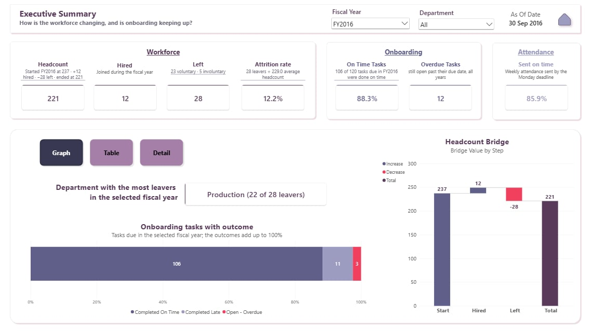
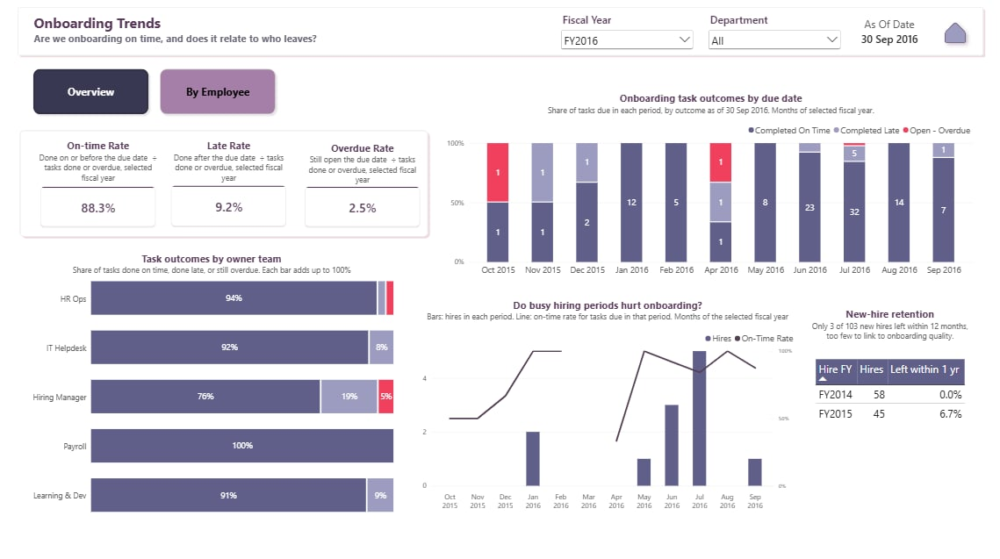

# HR Workforce & Onboarding Dashboard

A Power BI report, fed by a Power Automate Desktop ETL flow, that answers three questions for an HR team: how the workforce is changing, whether new hires are onboarded on time, and whether every department submits its weekly attendance.

The workforce data is real: the public Kaggle [Human Resources Data Set](https://www.kaggle.com/datasets/rhuebner/human-resources-data-set) by Huebner. The onboarding tasks and weekly attendance submissions are synthetic, generated from the real hire and termination dates. Every number in the report is reconciled against an answer key computed independently from the raw files.

All figures are as of a fixed date, **30 Sep 2016**, and use a fiscal year that runs from 1 October to 30 September.





> **No row-level data is included in this repository.** The Kaggle dataset is published as "Data files © Original Authors", so it is not redistributed here, and neither is anything built from it row by row. [How to get the data](#how-to-get-the-data) explains how to rebuild every file locally.

## Contents

1. [What the report shows](#what-the-report-shows)
2. [How it works](#how-it-works)
3. [Data sources](#data-sources)
4. [Report pages](#report-pages)
5. [Definitions](#definitions)
6. [Quality assurance](#quality-assurance)
7. [How to get the data](#how-to-get-the-data)
8. [Importing the flow](#importing-the-flow)
9. [How to refresh](#how-to-refresh)
10. [Decision log](#decision-log)
11. [Known limitations](#known-limitations)
12. [Repository layout](#repository-layout)
13. [Credits and AI assistance](#credits-and-ai-assistance)

## What the report shows

The window is FY2014 to FY2016 (1 Oct 2013 to 30 Sep 2016).

| Measure | FY2014 | FY2015 | FY2016 |
|---|---|---|---|
| Headcount at year end | 208 | 237 | 221 |
| Hires | 58 | 45 | 12 |
| Leavers | 12 | 16 | 28 |
| Attrition rate | 6.5% | 7.2% | 12.2% |
| Onboarding tasks done on time | 84.6% | 82.1% | 88.3% |
| Weekly attendance sent on time | 88.5% | 91.7% | 85.9% |

FY2016 is the story year. Leavers outnumbered hires for the first time (28 against 12), and 22 of the 28 came from Production. As of 30 Sep 2016, 12 onboarding tasks were open past their due date, half of them owned by hiring managers.

The attrition figures come from real data. The onboarding and attendance figures come from synthetic data, so their patterns are illustrations, not findings. See [Data sources](#data-sources).

## How it works

```
 01_raw                 HR_ETL_Pipeline              02_clean
 3 messy sources   -->  Power Automate Desktop  -->  3 clean CSVs + run log
                                                          |
                                                          v
 Report pages      <--  DAX measures            <--  Power Query + star schema
 8 pages                one rule, one measure        typing, lookups, as-of logic

 QA answer key: computed in Python from 01_raw, independent of Power BI.
 It checks the clean files, the model and every report page.
```

Each layer has one job.

- **Power Automate Desktop** does the file-level work: skipping title rows, dropping and renaming columns, removing blank and duplicate rows, standardising values and dates, and unpivoting and combining the attendance files.
- **Power Query** sets data types, merges lookups, and applies the as-of date.
- **DAX** holds the business rules. Each rule in [Definitions](#definitions) is written once as a measure, and visuals reuse the measures.

The model is a star schema. All relationships are one-to-many and filter in one direction.

| Table | Role | Rows |
|---|---|---|
| Employees | Dimension | 302 |
| Departments | Dimension | 6 |
| OwnerTeams | Dimension | 5 |
| TaskOutcomes | Dimension | 5 |
| DimDate | Date table (fiscal calendar) | 1,461 |
| OnboardingTasks | Fact | 1,265 |
| Attendance | Fact | 942 |

## Data sources

| File | Source | Grain | What was messy |
|---|---|---|---|
| `HRDataset_v14.csv` | Real, Kaggle Human Resources Data Set, 311 rows | One row per employee | Trailing spaces, irregular name spacing, duplicated code columns, personal data the report does not need, and an employment status that reflects 2019 |
| `OnboardingTasks_Export_20160930.xlsx` | Synthetic, 1,275 rows | One row per task per new hire (11-step checklist) | Two title rows, wrong headers, 3 blank rows, 7 exact duplicates, three date formats, statuses and owners spelled several ways |
| `Attendance_FY2014.xlsx` to `Attendance_FY2016.xlsx` | Synthetic, 3 files | One row per department, one column per week | A title row, week dates buried in headers, department names that differ from HR |
| `00_reference/*.csv` | Built for this project | Lookups | Onboarding checklist, termination-reason categories, value map for cleaning |

The ETL flow drops 25 columns from the employee file, including date of birth, race, marital status and salary. The report has no reason to hold them.

### About the synthetic data

Onboarding tasks and attendance submissions were generated from the real hire and termination dates so that the report could show onboarding and attendance alongside real attrition. The generator has three built-in assumptions. The patterns they create are illustrative, not findings.

1. **Large hiring batches slow support teams.** When 8 or more people start on the same day, IT Helpdesk and HR Ops tasks are more likely to be late. This is why IT Helpdesk's on-time rate dips to 67.8% in FY2015.
2. **Managers who lose team members fall behind on reviews.** After a departure, that manager's 30, 90 and 180-day reviews are more likely to slip.
3. **Production submitted attendance less reliably in FY2016.** This is why Production's on-time submission rate falls to 65.4% that year.

### One data-quality finding

Two leavers have a free-text termination reason that contradicts their HR status: one "attendance" exit and one "performance" exit are both marked Voluntarily Terminated. The report treats the HR status field as authoritative and states the conflict on its About page.

## Report pages

| Page | Question it answers | Main visuals |
|---|---|---|
| Home | Where do I start? | The FY2016 story in three numbers, how to use the report, and one tile per page with its question |
| Executive Summary | How is the workforce changing, and is onboarding keeping up? | Seven KPI cards, a headcount waterfall, task outcomes, and three views (Graph, Table, Detail) |
| Workforce & Attrition | Who is leaving, from where, and why? | Hires and leavers with headcount, attrition by department and year against a target, leaver reasons, year-over-year table |
| Overdue & Action Queue | What must be finished now, and whose job is it? | Overdue now, overdue rate and due-soon cards, the action queue with days overdue, overdue tasks by owner team, tasks due in the next 30 days. Everything is as of today, across all years |
| Onboarding Trends | Are we onboarding on time, and does it relate to who leaves? | On-time, late and overdue rate cards that add to 100%, task outcomes by month, task outcomes by owner team, hires against on-time rate, new-hire retention by hire year, and a By employee view covering all years |
| Attendance Submissions | Did every department send its weekly attendance? | On-time rate by department and month, the yearly trend by department with Production highlighted, and who submitted in the last 8 weeks |
| About | What do these numbers mean? | Data statement, synthetic-data assumptions, report rules, definitions, refresh steps |
| QA Checks (hidden) | Is every number right? | Check measures that must read 0, and the ETL run log |

Every page uses the same header: the title and the page's question on the left; the Fiscal Year and Department slicers, the as-of date and a Home button on the right. A slicer that does not apply to a page leaves its slot empty, so the others never move. Each card has a subtitle that says how its number was calculated.

Four rules apply to every page:

- **The year is chosen with the slicer.** There is no drill-down. Time charts show the 12 months of the selected fiscal year, and visuals that compare years show all years and say so in their subtitle.
- **Rates are shown as a full set.** Wherever an on-time rate appears, the late and overdue rates appear with it, so the three add to 100%.
- **Pages read in a Z.** The headline number sits top-left, the controls top-right, the explanation below, and the detail or action list last.
- **Colours keep one meaning.** Blue-violet is the normal data, light violet is late or comparison, and coral red is used only for what needs attention: leavers, overdue, missing and rates above target.

## Definitions

Every number in the report comes from one of these rules.

| Term | Rule | Why it is defined this way |
|---|---|---|
| As-of date | Fixed at 30 Sep 2016, stored once as the Power Query parameter `AsOfDate`. `TODAY()` is not used anywhere. | The report shows the same numbers every time it is opened. In production the parameter would point at the refresh date. |
| Fiscal year | 1 October to 30 September, named by the year it ends. FY2016 is 1 Oct 2015 to 30 Sep 2016. | It follows a fiscal calendar that starts in October. |
| Which date counts | Hires by hire date, leavers by termination date, tasks by due date, attendance by week-ending date. | A fiscal year selection means the same thing on every visual. |
| Headcount on a date | Hired on or before the date, and either not terminated or terminated after it. | Standard point-in-time headcount. |
| Headcount bridge | Start headcount (the day before the period) + hires - leavers = end headcount. | It always holds, so the cards add up on screen. |
| Leaver | Termination date inside the period and on or before the as-of date. Later terminations count as active. | Otherwise exits from 2017 and 2018 would leak into a 2016 snapshot. |
| Voluntary and involuntary | Taken from the HR employment status field. | The free-text reason sometimes disagrees with the status. One field has to be authoritative. |
| Attrition rate | Leavers ÷ average headcount, where average is (start + end) ÷ 2. Shown for fiscal years. Monthly views show counts only. | A monthly rate on about 230 people swings too much to be useful. |
| First-year attrition | Share of a hire cohort who left within 365 days. Only cohorts with a full year elapsed are shown. | Counting FY2016 hires would understate it, because they have not had a year to leave. |
| Task outcome | Exactly one of: `Completed On Time`, `Completed Late`, `Open - Overdue`, `Open - Not Yet Due`, `Cancelled`. | The five always sum to total tasks. |
| Overdue | Open, with a due date before the as-of date. A task due on the as-of date is not yet overdue. | |
| Cancelled | The employee left before the task was due or done, so the task was closed at offboarding. | Tasks for people who have left cannot be overdue. |
| Accountable tasks | Completed tasks plus open overdue tasks: work that is done or should be done. | It is the shared denominator for the three rates. |
| On-time, late and overdue rate | Each outcome ÷ accountable tasks. The three sum to 100%. For the selected fiscal year, except on Overdue & Action Queue and in the By employee view, which show all years. | An on-time rate that ignores overdue work flatters the result. |
| Days overdue | Days from the due date to the as-of date, for tasks still open past their due date. | It shows which work has been forgotten longest. |
| Employee onboarding status | The first that applies: Left Company, In Progress with overdue tasks, In Progress and on track, Onboarding Complete. | One status per person, in the same words as the task outcomes. |
| Attendance submission | Due the Monday after the week-ending Friday. On Time, Late, Missing, or Not Yet Due. | Not Yet Due is left out of rates so the final week does not count as missed. |
| On-time submission rate | On Time ÷ (On Time + Late + Missing). | |
| Leavers YoY % | (Leavers this year - leavers last year) ÷ leavers last year. FY2016: (28 - 16) ÷ 16 = 75.0%. | It shows how fast exits are growing, not only how many there were. |
| Headcount YoY % | (Headcount at this year end - headcount at last year end) ÷ headcount at last year end. FY2016: (221 - 237) ÷ 237 = -6.8%. | |
| Attrition target | 20% a year, shown on the Workforce & Attrition page. Department rates above it are shaded. | The dataset has no target. The value was set on the advice of the second reviewer, so the colours follow a stated rule. |

## Quality assurance

A number is correct only when it matches `03_qa/QA_Answer_Key.xlsx`. The key was computed in Python directly from the raw files, independently of Power BI, and covers every visual. If a number differs, the ETL or the DAX is wrong, not the key.

### Three reconciliation layers

1. **ETL output.** The three clean CSVs were compared with expected clean files. Row counts match: 311 employees, 1,265 tasks (1,275 in, 7 duplicates and 3 blank rows removed), 942 attendance rows (18 wide rows unpivoted).
2. **Data model.** Every row of the expected-numbers table below was reconciled before any page was designed.
3. **Report pages.** Each page was reconciled against the key for more than one fiscal year before the next page was built.

### Four check measures

These sit on the hidden QA Checks page and must read 0 in every row and total.

| Measure | What it proves |
|---|---|
| Check Headcount Bridge | Start + hires - leavers equals end headcount |
| Check Task Outcomes | The five outcomes sum to total tasks |
| Check Rates Sum | On-time, late and overdue rates sum to 100% |
| Check Attendance | On time + late + missing equals expected submissions |

### Manual checks

- **Three numbers rebuilt by hand** in Excel pivots on the clean CSVs: FY2016 leavers by department (Production 22, IT/IS 6), overdue tasks by owner team (6, 3, 2, 1), and Production's FY2016 attendance (34 of 52 on time).
- **Sample tasks traced** from the raw export to the clean CSV to their outcome in the report.
- **As-of date test.** The parameter was changed to 30 Jun 2016, the report refreshed, and the numbers moved as expected. It was then set back to 30 Sep 2016.
- **Click test.** Every slicer, view button, Home tile and Home button, for FY2014, FY2015 and FY2016 and with one department picked, checking for blank or doubled numbers.
- **Failure test.** A source file was renamed to confirm the flow logs an error and stops.
- **Rebuild test.** The scripts were run in an empty folder holding only the Kaggle file. The onboarding export, the three attendance workbooks and the answer key came out identical to the originals, cell for cell.

### Expected numbers (as of 30 Sep 2016)

| Check | Expected |
|---|---|
| Employees in scope | 302 |
| Headcount, start of FY2014 | 162 |
| Leavers who left voluntarily, FY2014 / FY2015 / FY2016 | 12 / 12 / 23 |
| FY2016 leavers by department | Production 22, IT/IS 6, all others 0 |
| Onboarding tasks | 1,265 = 1,039 on time + 189 late + 12 overdue + 17 not yet due + 8 cancelled |
| All-years on-time / late / overdue rate | 83.8% / 15.2% / 1.0% of 1,240 accountable tasks |
| FY2016 on-time / late / overdue rate | 88.3% / 9.2% / 2.5% of 120 |
| Overdue now, by owner team | Hiring Manager 6, HR Ops 3, IT Helpdesk 2, Learning & Dev 1, Payroll 0 |
| Employee onboarding status (115 onboarded) | 86 complete, 12 with overdue tasks, 8 on track, 9 left the company |
| First-year attrition, FY2014 and FY2015 cohorts | 0% (0 of 58) and 6.7% (3 of 45) |
| Attendance, FY2016 | 85.9% on time, 16 missing, Production 65.4% on time |

## How to get the data

This repository holds the flow, the report template, the scripts, the measures and the QA evidence, but no data rows. To rebuild the data on your own machine you need Python 3 with `pandas`, `numpy` and `openpyxl` (`pip install pandas numpy openpyxl`).

1. Make an empty working folder and save `HRDataset_v14.csv` from the [Kaggle page](https://www.kaggle.com/datasets/rhuebner/human-resources-data-set) into it.
2. Open a terminal in that folder and run `python <path to repo>/04_scripts/generate.py`. It creates a `project_files` folder holding `00_reference` (the checklist and reason map) and `01_raw` (the Kaggle file, the synthetic onboarding export and the three attendance workbooks). The script is seeded, so it produces the same files on every run.
3. Optional, to rebuild the answer key: copy `00_reference/ValueMap.csv` from this repository into `project_files/00_reference`, then run `python <path to repo>/04_scripts/reference_etl.py` in the same folder. It writes `02_clean_expected` and `03_qa/QA_Answer_Key.xlsx`, which matches the copy in this repository. The published copy leaves two columns out of the Overdue_Action_Queue tab, EmployeeName and AssignedTo, because they hold names from the dataset.
4. Copy `project_files/01_raw` into your copy of this repository, so it sits beside `00_reference`.
5. Run the flow (see [Importing the flow](#importing-the-flow)). It writes the clean CSVs and the run log into `02_clean`.
6. Open `06_report/HR_Workforce_Analytics.pbit`. Power BI asks for three values: `AsOfDate` (9/30/2016), `CleanFolder` (the full path to your `02_clean` folder) and `RefFolder` (the full path to `00_reference`). It then loads the data and opens the report.
7. Open the QA Checks page and confirm every check reads 0.

## Importing the flow

The flow is in `05_flow`, one text file per subflow.

1. In Power Automate Desktop, create a new flow named `HR_ETL_Pipeline`.
2. Create five subflows with these exact names: `Clean_Employees`, `ParseDate`, `Clean_Onboarding`, `Unpivot_Attendance` and `Log_Error`. They must exist before Main is pasted, because Main calls them.
3. Open each tab, click the empty canvas, and paste the contents of the matching text file with **Ctrl + V**. Paste `01_Main.txt` into the Main tab last.
4. In Main, set `RootFolder` to your copy of the project folder. The files show it as `<project folder>`.

## How to refresh

1. Run `HR_ETL_Pipeline` in Power Automate Desktop. It reads `01_raw` and writes three clean CSVs and a run log to `02_clean`.
2. Open the report (your saved `.pbix`, or the `.pbit` template the first time) and click **Home → Refresh**.
3. Open the QA Checks page and confirm every check column reads 0.

Raw files are read-only. They are never opened and saved in Excel, because Excel would silently reformat the dates.

## Decision log

An early draft of this report was reviewed by a data analyst at CGI. Several of the decisions below came from that feedback: lead with attrition, use a fiscal calendar, fix the as-of date, move the automation to ETL, and write the QA down. A later review by a senior automation developer at CGI led to decisions 16 to 19, and his design review led to decisions 20 to 22 and the revised decisions 8, 15 and 17.

| # | Decision | Problem | Resolution | Why it matters |
|---|---|---|---|---|
| 1 | Real attrition data first | A handful of made-up employees could not support trends, fiscal years or year-over-year comparison | Real Kaggle HR data, with onboarding and attendance generated on its hire dates and disclosed | Stakeholders care most about attrition, and realism needs volume and time |
| 2 | Fixed as-of date | Numbers shifted every day, so the report could not be checked | One `AsOfDate` parameter feeding Power Query and DAX | A report that cannot be reproduced cannot be trusted or tested |
| 3 | No email alerts | Reviewer feedback: alerts go unused when the dashboard carries the information | Power Automate Desktop repurposed as the ETL layer | Build what users use |
| 4 | Power Automate Desktop does the ETL | Raw exports had title rows, bad headers, wide attendance and mixed formats | The flow skips, renames, removes duplicates, maps values, unpivots and combines files into clean CSVs | Clean, stable inputs before Power BI, with one job per layer |
| 5 | Five mutually exclusive task outcomes | Cards built on overlapping categories (open, overdue, total) do not add up | Outcomes sum to total tasks, and the rates share one denominator | Numbers a stakeholder can add up without help |
| 6 | Fiscal calendar, October to September | Calendar months did not match how the business reports | A date table with fiscal year, quarter and month; month is the lowest grain | It speaks the business's language |
| 7 | Owner team, not department, carries overdue work | A department chart blamed departments for work owned by support teams | Overdue tasks by owner team, and an action queue by owner | Accountability is shown where it belongs |
| 8 | Days overdue in the action queue | A due date such as 10 Nov 2013 left the reader to work out how late the task was. An early version left the column out as noise; the design review showed it was the clearest signal | A Days overdue column, shaded darker for older tasks, replaces the task ID. The queue is sorted oldest first | The work forgotten longest stands out first |
| 9 | No average-days-variance card | Stakeholders could not interpret a figure such as -0.38 | Replaced by on-time, late and overdue rates | Every card must explain itself |
| 10 | Separation type from the HR status field | Free-text reasons contradicted the status for 2 leavers | The status field is authoritative, and the conflict is documented | Pick one source of truth per attribute and say which |
| 11 | Single-direction relationships only | Bidirectional filters can hide rows unexpectedly | Dimensions filter facts one way | Predictable filtering |
| 12 | Independent answer key | Hand checks that are not written down cannot be repeated or shown | Python recomputes every number from the raw files, and the report must match | QA is evidence, not a claim |
| 13 | Guard period measures against a blank date | A "(Blank)" month appeared with a huge bar, because the date table's hidden blank row made the leavers measure count every employee with no termination date | Hires, leavers and headcount return blank when the period has no start date | A measure must be right for every row a visual can show |
| 14 | Views only where the canvas needs them | Some pages had more visuals than fit, others did not | Executive Summary has three views, Onboarding Trends has two, and the rest have none | Bookmarks are fragile, so they are used only to solve a real space problem |
| 15 | Slicers in one fixed place | Slicers sat in different places on different pages, and Onboarding Trends had none, while the reviewer noted that users filter time with slicers | Fiscal Year (single select) and Department sit in the same header slots on every page. Onboarding Trends has its year slicer back. Overdue & Action Queue has no year slicer, because everything on it is as of today across all years | The reader finds the controls in the same place every time, and only where they change something |
| 16 | Rates shown as a full set | An on-time rate shown alone left the reader asking where the rest of the 100% went | A late rate card sits beside on-time and overdue, and the owner-team visual is a 100% stacked bar of all three outcomes | A share only means something when the whole is visible |
| 17 | No drill-down; the slicer picks the year | Charts of 36 months were hard to read. Drill-down was the first fix, but the reviewer noted that users do not drill, and a drilled chart combined with a year slicer could go blank | Time charts show the 12 months of the year picked in the slicer. Visuals that compare years show all years, ignore the slicer, and say so in their subtitle | Build for how people actually use reports |
| 18 | A stated attrition target | Heatmap colours implied good and bad without saying what the benchmark was | A 20% target, set on the reviewer's advice, is shown on the page, and only rates above it are shaded | Colour needs a stated rule behind it |
| 19 | Formulas shown beside the numbers | Year-over-year and overdue figures appeared without their calculation | Each formula is in the visual's subtitle and in the definitions | A reader should not have to ask how a number was made |
| 20 | A Home page | The report opened on a dense page with no map, and the About page mixed a page guide with definitions | Home shows the FY2016 story in three numbers and one tile per page with its question. Every page has a Home button. About keeps only the data notes, rules and definitions | Each page has one job, and nothing is said twice |
| 21 | One question per page, laid out in a Z | Visuals were placed where they fit, so pages did not read in an order | Each page answers its question in reading order: headline number top-left, controls top-right, explanation below, detail or action list last. KPI cards are grouped in shapes by topic | The layout tells the story before the reader reads a title |
| 22 | Colours with fixed meanings | Bright greens and reds filled the pages, and the same colour meant different things on different pages | A custom theme from five colours. Coral red is used only for what needs attention, the one problem series is highlighted, and the rest is greyed | Red only works as a warning when it is rare |

## Known limitations

- **Synthetic onboarding and attendance data.** Patterns in those two areas reflect the generator's assumptions, not real behaviour.
- **Fixed as-of date.** The report is a snapshot at 30 Sep 2016. Pointing `AsOfDate` at the current date would make it live, but that has only been tested by moving the date within the data's range.
- **Manual refresh.** The project uses the free desktop versions of Power BI and Power Automate. The flow is run by hand, and the report is not published to the Power BI Service or scheduled.
- **Small groups swing hard.** One leaver in Admin Offices is about 20% attrition. Department rates should be read with their headcount.
- **First-year attrition is a small sample.** Only 3 of 103 new hires left within 12 months, too few to link early attrition to onboarding quality.
- **The attrition target comes from review, not from the data.** The dataset does not include one. The 20% value was suggested by a reviewer, and a real deployment would use the organisation's own target.
- **Views and PDF export.** A PDF export captures only the view showing on each page, so the Table, Detail and By employee views do not appear in it.
- **Source status field.** The Kaggle employment status reflects 2019. The report derives who was active from hire and termination dates against the as-of date instead.

## Repository layout

```
hr-workforce-analytics/
├─ 00_reference/   lookups: onboarding checklist, reason map, value map
├─ 01_raw/         not included; rebuilt locally (see How to get the data)
├─ 02_clean/       ETL_RunLog.csv; the flow writes the clean CSVs here
├─ 03_qa/          QA_Answer_Key.xlsx and the QA screenshots
├─ 04_scripts/     Python scripts for the synthetic data and the answer key
├─ 05_flow/        the Power Automate Desktop flow, one text file per subflow, and screenshots
├─ 06_report/      report template (.pbit), PDF, screenshots and measures.md
└─ README.md
```

## Tools

Power BI Desktop, Power Automate Desktop, Power Query, DAX, Excel.

## Credits and AI assistance

- The workforce data is the [Kaggle Human Resources Data Set](https://www.kaggle.com/datasets/rhuebner/human-resources-data-set) by Huebner, published as "Data files © Original Authors". This repository links to it and does not redistribute it.
- The synthetic onboarding and attendance files, the Python scripts in `04_scripts`, and the QA answer key were generated with AI assistance.
- The Power Automate Desktop flow, the data model, the DAX measures, the report pages and the reconciliation were built by the author, with AI used for guidance and review.
